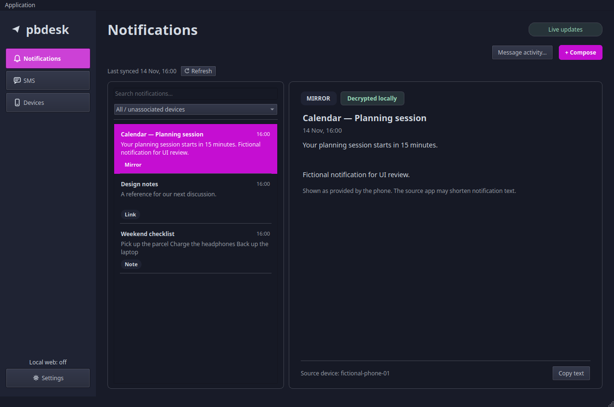
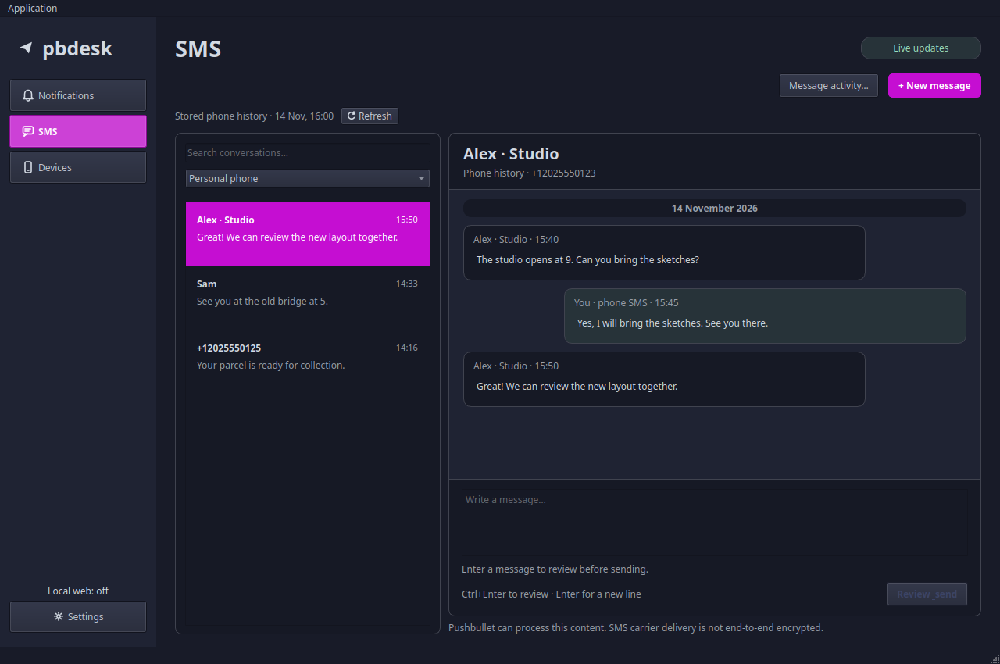
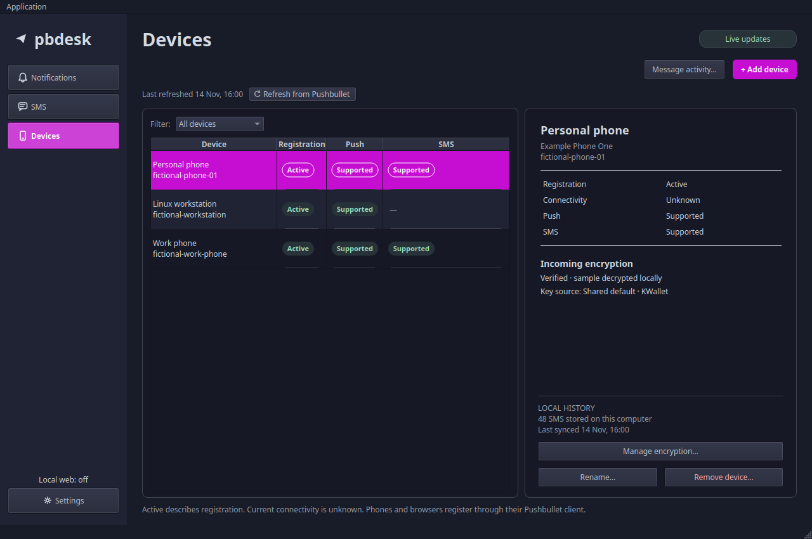
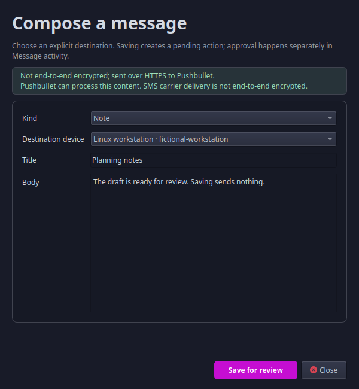
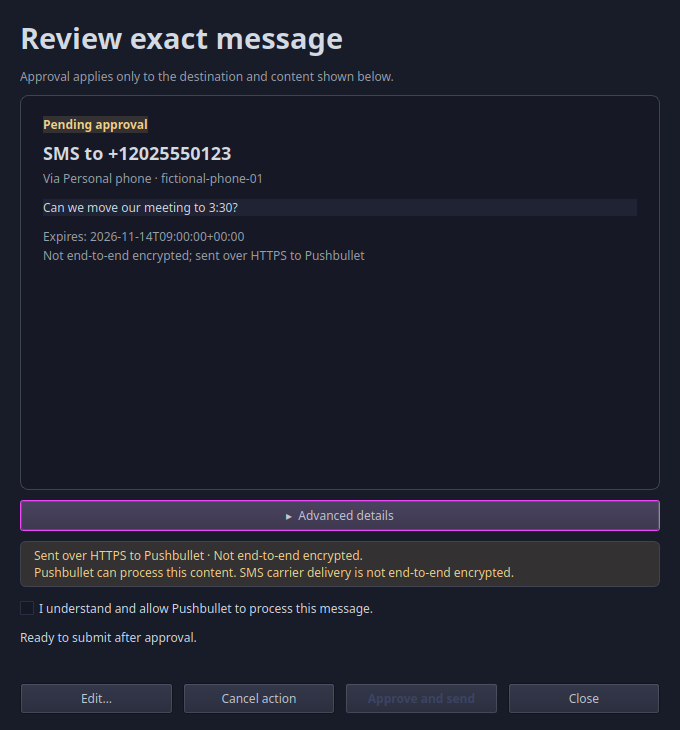
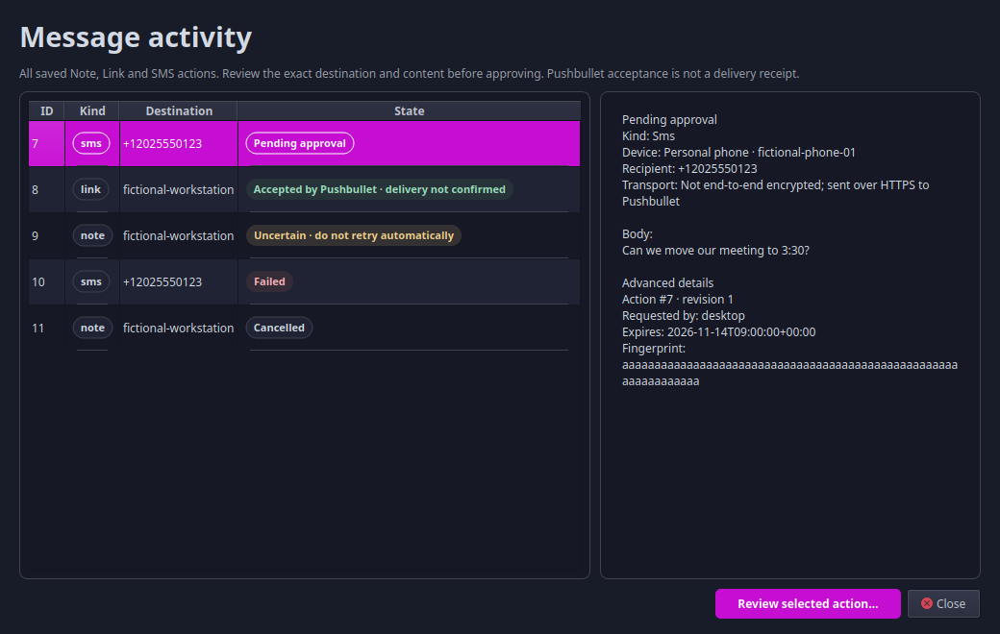

# pbdesk

A native Pushbullet desktop for Linux (built on Kubuntu 26.04, KDE Plasma 6, Wayland, CPython 3.14). PyQt6 Widgets on the front, one private Python core behind it. No embedded browser, Node.js, CDN or JS build step.



*All screenshots use fictional fixture data.*

## What it does

- **Notifications**: stored pushes and mirrored phone notifications, with source-device filtering and search.
- **SMS**: pick a phone, browse its conversations, read the history as chat bubbles, and write replies below the timeline.
- **Devices**: see registrations and capabilities, register this computer, rename or remove devices, and manage local decryption.
- **Sending**: notes, links and SMS go through a saved, reviewable action. Nothing is sent until you approve it.
- **Encryption**: incoming end-to-end encrypted content is decrypted in the core using your local KWallet credentials. If a key is missing or wrong, readable history stays and the encrypted originals are kept for recovery.

AI, automations and browser inbox access are not built yet. See [feature parity](docs/feature-parity.md) and the [specification](docs/specification.md).

## Screens

| | |
| --- | --- |
|  |  |
| **SMS**: conversations on the left, chat and composer on the right. | **Devices**: capabilities, encryption state and local history for each registration. |

Keyboard: `Ctrl+N` composes (an inline draft on SMS), `Ctrl+F` focuses search, `F5` refreshes. Browsing Notifications never changes which phone SMS sends from.

## Sending and approval

Saving a message creates a pending action. **Message activity** lists every saved Note, Link and SMS action, including failed and uncertain ones.

| | |
| --- | --- |
|  |  |
| **Compose** saves a pending action. It sends nothing. | **Review** shows the exact destination, content and expiry. |



To send, open the review and check the plaintext-consent box, then choose **Approve and send**. Approval is tied to that exact revision and fingerprint. Editing an action invalidates the earlier approval.

Outgoing messages use `provider_plaintext` over TLS to Pushbullet. Pushbullet can read them, and SMS carrier delivery is not end-to-end encrypted. The E2E password only decrypts incoming events. There is no automatic fallback to another transport.

Action states are pending approval, queued, submitting, accepted by Pushbullet, failed, uncertain, expired and cancelled. *Accepted by Pushbullet* is not a delivery receipt. If an outcome is *uncertain* the message may already have been sent, so check the destination before creating another one. The app never retries a send on its own. If saving times out, **Reconcile same request** asks the core about the same request instead of creating a duplicate.

## Install

The development environment is `.venv` on standard CPython 3.14. `requirements.lock` pins what was tested.

```bash
python3 -m venv --without-pip .venv
python3 -m pip --python .venv install pip==26.3
.venv/bin/python -m pip install -r requirements.lock
.venv/bin/python -m pip install --no-build-isolation --no-deps -e .
```

The system has no `ensurepip`, so this bootstraps pip from the system pip. Only these install commands download anything. The app itself downloads nothing at startup.

For a core-only install (no Qt, Jinja2, MCP or test extras), start from a fresh `.venv`:

```bash
python3 -m venv --without-pip .venv
python3 -m pip --python .venv install pip==26.3
.venv/bin/python -m pip install -r requirements-core.lock
.venv/bin/python -m pip install --no-deps .
```

## Run

Launch the **pbdesk: Desktop** profile in VS Code or Zed. It connects to the editor core on port 18765, keeps service state in `.runtime/editor`, and uses the `pbdesk.sqlite3` in the project root. A bare `python -m pbdesk.desktop` uses different state and ports, so use the profile to open this setup.

The desktop checks the core's signed identity before sending it a credential. If no core is running, it starts one as a transient `systemd --user` unit, or as a detached process if that fails. Both paths share a single-instance guard. If something else is listening on the port you get an error, and the launcher never kills it.

Try it without a Pushbullet account, using fictional demo data:

```bash
PBDESK_STATE_DIR=/tmp/pbdesk-demo PBDESK_APPLICATION_DIR=/tmp/pbdesk-demo-app .venv/bin/python -m pbdesk.desktop --demo
```

`--demo` only applies to a core started by that launch. An already running core keeps its mode.

Closing the window hides it when a system tray is available. **Exit desktop** leaves the core and web host running. **Stop all services…** stops both and disconnects other windows and MCP clients. Login autostart is off.

### Editor profiles

VS Code profiles are in `.vscode/launch.json` and Zed profiles in `.zed/debug.json`, with matching run tasks in `.vscode/tasks.json` and `.zed/tasks.json`. They cover the desktop, a demo desktop, a foreground demo core, a standalone web status host, and headless tests. None of them install anything.

| Profiles | State directory | Core port | Web port |
| --- | --- | --- | --- |
| Desktop | `.runtime/editor` | 18765 | 18766 |
| Demo desktop, demo core, standalone web | `.runtime/editor-demo` | 18767 | 18768 |

To debug backend code, start **Core (demo, foreground)** first, then **Desktop (demo)**. Don't run the standalone web profile next to a managed web listener on the same port.

## Provider setup

Run a standalone core for development or headless use:

```bash
.venv/bin/python -m pbdesk.cli --foreground
.venv/bin/python -m pbdesk.cli --foreground --demo --notifications
.venv/bin/pbdesk-diagnostics
```

`--notifications` turns on the core's KDE notification adapter. The core is the only thing that emits notifications, and each one is claimed at most once, so restarts don't repeat them. A submitted notification isn't guaranteed to pop up, for example under Do Not Disturb.

Store a Pushbullet access token in Secret Service or KWallet:

```bash
.venv/bin/pbdesk-admin provider-token
```

It prompts for the token, checks it reads back from the secure store, and refuses to fall back to plaintext. Afterwards, reload credentials from the Application menu or restart the core.

To reuse an existing KWallet entry instead (shown for the editor profile):

```bash
PBDESK_STATE_DIR="$PWD/.runtime/editor" .venv/bin/pbdesk-admin use-kwallet \
  --wallet kdewallet --folder Pushbullet --entry api-key
```

`Pushbullet` is the KWallet folder and `api-key` is the entry. Without `--wallet` it uses the current network wallet. Setup confirms the entry can be read and saves only its location, in `provider-credential.json` inside that state directory. The password itself isn't moved or copied. Each state directory has its own selection, so leave the override off when configuring the default command-line setup.

The core reads KWallet over the session D-Bus using Jeepney, so it needs neither Qt nor dbus-python. Allow `pbdesk` if KWallet prompts. A locked, denied or missing entry shows as a locked provider state, with no fallback to another entry or a file. Demo mode skips credentials.

The encryption password is a separate **`e2e-password`** entry in the same `Pushbullet` folder, next to `api-key`. The desktop and MCP never see stored passwords or tokens. You can enter a new device-specific password (masked) in the desktop, which passes it once to the core for KWallet storage. After changing it, use **Application → Reload provider credentials** to reconnect and retry the stored encrypted events.

Force the foreground fallback during development:

```bash
PBDESK_LIFECYCLE=foreground .venv/bin/python -m pbdesk.desktop
```

`pbdesk-admin install-service` installs a persistent user unit if you want one. Normal launches never do, and installing it doesn't enable login autostart.

## Local web status page

Off by default. Turn it on in **Application → Web interface settings…**, or from the CLI:

```bash
.venv/bin/pbdesk-web status
.venv/bin/pbdesk-web enable
.venv/bin/pbdesk-web disable
```

It's a small Jinja2 page with bundled Bootstrap 5.3.8 that shows service availability only. It has no inbox, login, session, forms, proxy, message content or credentials. It binds to loopback only. Remote access stays off the table until authentication, sessions, CSRF protection, HTTPS, revocation, throttling and a second factor exist.

`python -m pbdesk.web` runs the host directly as a smoke check without changing the core's saved preference. Don't run it while the managed listener uses the same port. Bundled assets, their sources, licence and SHA-256 hashes are in the [vendor manifest](src/pbdesk/web/vendor-manifest.json).

## Configuration

All processes must share the same state directory and ports.

| Variable | Default |
| --- | --- |
| `PBDESK_STATE_DIR` | `$XDG_STATE_HOME/pbdesk`, or `~/.local/state/pbdesk` |
| `PBDESK_APPLICATION_DIR` | Launcher directory (source launches use the project directory) |
| `PBDESK_CORE_PORT` | `8765` |
| `PBDESK_WEB_PORT` | `8766` |
| `PBDESK_LIFECYCLE` | transient user systemd with process fallback; `foreground` skips systemd |

The database `pbdesk.sqlite3` lives in the application directory with an ownership lock. Source and IDE launches set that directory explicitly, and demos and tests should set both `PBDESK_STATE_DIR` and `PBDESK_APPLICATION_DIR`. A database found in the state directory is migrated using a consistent backup, and the original is kept. If two histories conflict, startup stops so you can reconcile them.

The core and web host bind to `127.0.0.1`, on different ports. The state directory is `0700`. Separate desktop, web and MCP service tokens are stored `0600` and can be revoked with `pbdesk-admin revoke-service --role ROLE`. Provider secrets live in the credential backend, not in those token files.

## MCP

An MCP stdio adapter (official Python SDK 2.3) exposes six narrow tools:

```bash
.venv/bin/python -m pbdesk.mcp_server
```

Point an MCP client at that command with the same environment as the core. Tools: `capabilities`, `search_notifications(query)`, `get_item(item_id)`, `list_devices`, `request_action(...)` and `action_status(action_id)`.

`request_action` needs a caller-generated UUID, the `provider_plaintext` transport, a device, and explicit content and recipient. It only creates a pending action, and a person still has to approve it in the desktop. Reuse the same UUID and payload to reconcile an unknown result. The adapter can't approve, send, edit or cancel actions, run SQL, shell or HTTP, or read secrets. Remote MCP is disabled.

## Tests

```bash
xvfb-run -a -s '-screen 0 1440x1000x24 -nolisten tcp' env QT_QPA_PLATFORM=xcb QT_X11_NO_MITSHM=1 WAYLAND_DISPLAY= MOZ_ENABLE_WAYLAND=0 PBDESK_APPLICATION_DIR=/tmp/pbdesk-tests-app PBDESK_STATE_DIR=/tmp/pbdesk-tests-state PBDESK_BROWSER_TEST=1 .venv/bin/python -m pytest -q
```

Run GUI tests on a private display so your desktop isn't disturbed. For the desktop tests alone, `QT_QPA_PLATFORM=offscreen .venv/bin/pytest tests/test_desktop*.py -q` works. The browser test uses the Firefox and geckodriver already on the machine, never downloads one, blocks outside HTTP(S), and is skipped if they're missing. Tests use fake providers and never send a real message.

Regenerate the screenshots above with the capture script on a private display:

```bash
PBDESK_CAPTURE_PRIVATE_DISPLAY=1 xvfb-run -a -s "-screen 0 1440x960x24" .venv/bin/python design/ui-review/capture_notifications_sms.py
```

Verification records, with test counts, live-account checks and captures for each revision:
[initial](docs/verification.md), [KWallet](docs/kwallet-verification.md), [messaging](docs/messaging-verification.md), [redesign](docs/redesign-verification.md), [Notifications/SMS](docs/notifications-sms-verification.md) and [consistent UI](docs/consistent-ui-verification.md). Design galleries are in [design/ui-review](design/ui-review).

## Status

Not built yet: rich attachments, persistent compose drafts (drafts are lost on restart), backup and retention tools, AI, automation, a web inbox with authentication, and remote deployment. The desktop polls the core every two seconds. Still to check against a live account: a fresh phone-triggered encrypted notification, then an approved note or SMS to a specific device.
